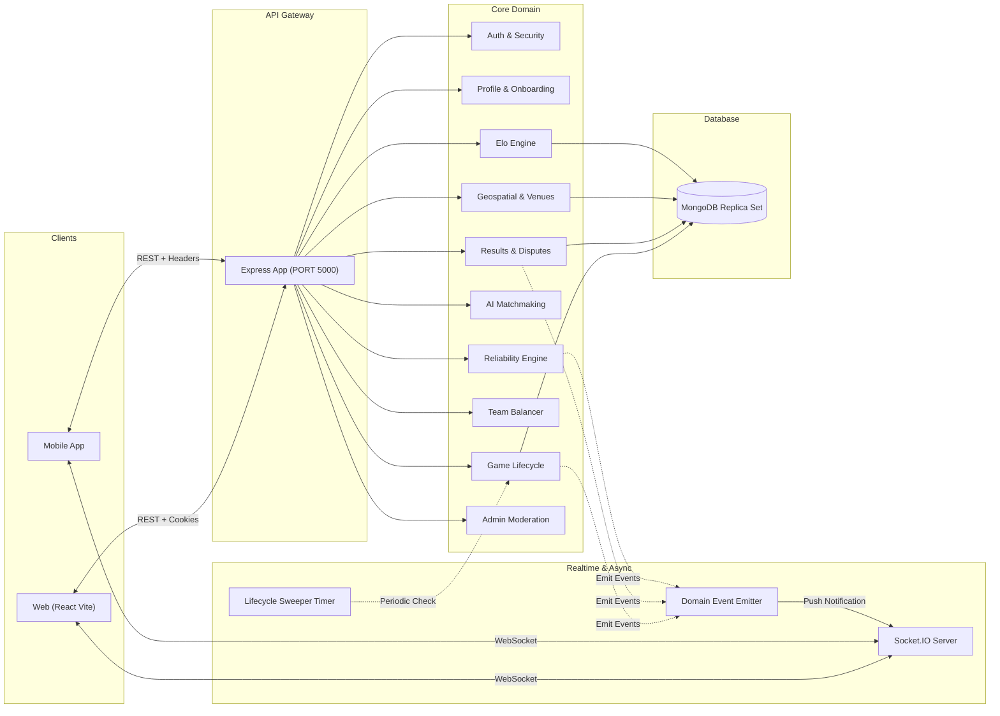

# PlayMatch Backend — Complete End-to-End Architectural & Business Logic Blueprint

This document provides a comprehensive, production-level reference for the **PlayMatch** backend system. It details every domain term, architectural layer, communication protocol, and an exhaustive, step-by-step endpoint-to-database execution workflow for all 12 modules.

---

## Table of Contents
1. [Core Domain Terminology & Data Glossary](#1-core-domain-terminology--data-glossary)
2. [Global Architecture & Request-Response Pipeline](#2-global-architecture--request-response-pipeline)
3. [Component Interconnectivity & Subsystems](#3-component-interconnectivity--subsystems)
4. [Complete Workflow & Implementation Guide: Modules 1 to 12](#4-complete-workflow--implementation-guide-modules-1-to-12)
   - [Module 1: Authentication & Security](#module-1-authentication--security)
   - [Module 2: Player Profiles & Onboarding](#module-2-player-profiles--onboarding)
   - [Module 3: Dynamic Elo Rating Engine](#module-3-dynamic-elo-rating-engine)
   - [Module 5: Geospatial Discovery & Court Reservation](#module-5-geospatial-discovery--court-reservation)
   - [Module 4: Game Lifecycle & Scheduling](#module-4-game-lifecycle--scheduling)
   - [Module 7: Balanced Team Formation](#module-7-balanced-team-formation)
   - [Module 6: AI Matchmaking & Recommendations](#module-6-ai-matchmaking--recommendations)
   - [Module 8: Results, Verification & Disputes](#module-8-results-verification--disputes)
   - [Module 9: Explainability & Decision Logs](#module-9-explainability--decision-logs)
   - [Module 10: Notifications & Real-Time WebSockets](#module-10-notifications--real-time-websockets)
   - [Module 11: Player Reliability & Attendance](#module-11-player-reliability--attendance)
   - [Module 12: Administration & Moderation](#module-12-administration--moderation)
5. [End-to-End Cross-Module Workflows](#5-end-to-end-cross-module-workflows)

---

## 1. Core Domain Terminology & Data Glossary

| Domain Term | Technical Representation | Business Meaning & Invariants |
| :--- | :--- | :--- |
| **User** | [`User`](file:///c:/Users/Dell/.gemini/antigravity-ide/scratch/playmatch/server/src/models/user.model.ts) | Core authenticated identity. Stores email, hashed password, account status (`ACTIVE`, `SUSPENDED`), role (`PLAYER`, `ADMIN`), failed login counters, and lockout timestamps. |
| **Refresh Session** | [`RefreshSession`](file:///c:/Users/Dell/.gemini/antigravity-ide/scratch/playmatch/server/src/models/refresh-session.model.ts) | Server-side refresh token tracking. Tokens are saved as SHA-256 hashes inside token families (`familyId`). Used for token rotation and theft detection. |
| **Player Profile** | [`PlayerProfile`](file:///c:/Users/Dell/.gemini/antigravity-ide/scratch/playmatch/server/src/models/player-profile.model.ts) | Athletic persona. Holds bio, birth date, sports roster, preferred availability matrix, search radius (km), GeoJSON home coordinates, and privacy mode (`EXACT` vs. `APPROXIMATE`). |
| **Skill Band** | `SkillLevel` enum | Initial self-assessed tier (`BEGINNER`, `INTERMEDIATE`, `ADVANCED`, `EXPERT`) mapping to seed Elo numbers (1000, 1200, 1500, 1800). **Permanently locked (`isLocked: true`)** upon completing the first rated match. |
| **Rating (Elo)** | [`Rating`](file:///c:/Users/Dell/.gemini/antigravity-ide/scratch/playmatch/server/src/models/rating.model.ts) | Current mathematical skill score per sport. Includes current Elo, peak Elo, match count, and win/loss tallies. Default rating is 1200. |
| **Rating Event** | [`RatingEvent`](file:///c:/Users/Dell/.gemini/antigravity-ide/scratch/playmatch/server/src/models/rating-event.model.ts) | Immutable ledger entry for every rating adjustment. Contains `ratingBefore`, `ratingAfter`, delta, K-factor, match ID, opponent IDs, and an audit status (`ACTIVE`, `VOIDED`, `REVERSED`). |
| **Game / Match** | [`Game`](file:///c:/Users/Dell/.gemini/antigravity-ide/scratch/playmatch/server/src/models/game.model.ts) | Scheduled athletic event. Enforces sport, court venue, start/end times, host, roster limit, waitlist queue, and lifecycle state. |
| **Waitlist** | `Game.waitlist` (FIFO array) | Overcapacity queue. When a confirmed player leaves, the first waitlisted player is automatically promoted via an ACID transaction. |
| **Leave Deadline** | Cutoff calculation | Calculated as `startTime - LEAVE_DEADLINE_MS` (typically 2 hours). Leaving before this deadline is penalty-free; leaving after triggers a 10-point reliability penalty. |
| **Venue & Court** | [`Venue`](file:///c:/Users/Dell/.gemini/antigravity-ide/scratch/playmatch/server/src/models/venue.model.ts) | Physical facility containing GeoJSON coordinates, operational hours, sports supported, and individual court numbers. |
| **Court Reservation** | [`CourtReservation`](file:///c:/Users/Dell/.gemini/antigravity-ide/scratch/playmatch/server/src/models/court-reservation.model.ts) | Reservation entry for a specific court at a venue for a time slot. Prevents double-booking using a compound unique index: `{ venue, courtNumber, date, timeSlot }`. |
| **Snake-Draft** | [`team.service.ts`](file:///c:/Users/Dell/.gemini/antigravity-ide/scratch/playmatch/server/src/services/team.service.ts) | Alternating selection algorithm (`A-B-B-A...`) that orders players by Elo to generate statistically balanced teams with minimal rating disparity. |
| **Game Result** | [`GameResult`](file:///c:/Users/Dell/.gemini/antigravity-ide/scratch/playmatch/server/src/models/game-result.model.ts) | Match score submission. Requires two-party confirmation: the opponent must confirm or dispute the score. Confirmed results trigger atomic Elo recalculations. |
| **Dispute** | State `DISPUTED` | Occurs when an opponent rejects a submitted score. Freezes rating updates until an administrator reviews evidence and resolves or voids the match. |
| **Decision Log** | [`DecisionLog`](file:///c:/Users/Dell/.gemini/antigravity-ide/scratch/playmatch/server/src/models/decision-log.model.ts) | Transparent, auditable snapshot explaining why a game was recommended or how an Elo update was computed. Redacts sensitive user data. |
| **Reliability Score** | [`reliability.service.ts`](file:///c:/Users/Dell/.gemini/antigravity-ide/scratch/playmatch/server/src/services/reliability.service.ts) | Score from 0 to 100 measuring trustworthiness and sportsmanship. Degraded by late cancellations and no-shows; restored by completed matches. Distinct from skill (Elo). |

---

## 2. Global Architecture & Request-Response Pipeline

Every incoming HTTP request travels through a predictable, layered pipeline before reaching the database:

```
[ Client Request (JSON / Cookie / Bearer Token) ]
                        │
                        ▼
┌─────────────────────────────────────────────────────────────┐
│ 1. Express Entrypoint & Security (src/app.ts)               │
│    • Helmet (Security headers)                              │
│    • CORS (Allowed origins, credentials: true)              │
│    • Cookie-Parser (Extracts playmatch_refresh)             │
│    • JSON Body Parser (10kb maximum payload limit)          │
│    • Request ID Middleware (Injects X-Request-Id header)    │
│    • Rate Limiter (IP-based sliding window)                 │
└─────────────────────────────────────────────────────────────┘
                        │
                        ▼
┌─────────────────────────────────────────────────────────────┐
│ 2. Routing & Path Dispatch (src/routes/index.ts)            │
│    • Dispatches to /api/v1/:module                          │
└─────────────────────────────────────────────────────────────┘
                        │
                        ▼
┌─────────────────────────────────────────────────────────────┐
│ 3. Security & Validation Middleware                         │
│    • authenticate: Extracts Bearer JWT, verifies signature, │
│      injects req.user = { userId, role }                    │
│    • authorize(Roles): Checks RBAC permissions              │
│    • requireOnboardingComplete: Validates player state      │
│    • validateRequest(ZodSchema): Validates body, query,     │
│      params. Returns 400 with field issues on failure       │
└─────────────────────────────────────────────────────────────┘
                        │
                        ▼
┌─────────────────────────────────────────────────────────────┐
│ 4. Controller Layer (src/controllers/*.controller.ts)       │
│    • Extracts validated inputs from req                     │
│    • Forwards calls to Domain Services                      │
│    • Wraps output in ApiResponse.success(data)              │
└─────────────────────────────────────────────────────────────┘
                        │
                        ▼
┌─────────────────────────────────────────────────────────────┐
│ 5. Domain Business Logic (src/services/*.service.ts)        │
│    • Executes state transitions and business validations    │
│    • Performs algorithmic math (Elo, Snake-Draft, AI Match) │
│    • Wraps multi-model writes in withTransaction()          │
└─────────────────────────────────────────────────────────────┘
                        │
                        ▼
┌─────────────────────────────────────────────────────────────┐
│ 6. Persistence & Events (src/models/ & src/utils/)          │
│    • Mongoose Models commit to MongoDB Replica Set          │
│    • domainEvents.emit() pushes decoupled background tasks  │
│    • Socket.IO emits WebSocket frames to private rooms      │
└─────────────────────────────────────────────────────────────┘
```

---

## 3. Component Interconnectivity & Subsystems



---

## 4. Complete Workflow & Implementation Guide: Modules 1 to 12

Below is the complete walkthrough for every module, organized in logical dependency order:

```
Module 1 (Auth) ──> Module 2 (Profile) ──> Module 3 (Elo) ──> Module 5 (Venues)
                                                                    │
┌───────────────────────────────────────────────────────────────────┘
▼
Module 4 (Game Lifecycle) ──> Module 7 (Teams) ──> Module 6 (AI Matchmaking)
      │
      ▼
Module 8 (Results & Disputes) ──> Module 9 (Explainability)
      │
      ▼
Module 10 (Sockets & Notifications) ──> Module 11 (Reliability) ──> Module 12 (Admin)
```

---

### Module 1: Authentication & Security

#### A. Purpose & Responsibility
Provides secure registration, credentials verification, session maintenance via short-lived JWTs and rotating refresh tokens, rate limiting, and brute-force lockout protection.

#### B. Key Endpoints & Routes ([`server/src/routes/auth.routes.ts`](file:///c:/Users/Dell/.gemini/antigravity-ide/scratch/playmatch/server/src/routes/auth.routes.ts))
| HTTP Verb | Path | Middleware | Controller Handler |
| :--- | :--- | :--- | :--- |
| `POST` | `/api/v1/auth/register` | `validateRequest(registerSchema)` | `AuthController.register` |
| `POST` | `/api/v1/auth/login` | `authRateLimiter`, `validateRequest(loginSchema)` | `AuthController.login` |
| `POST` | `/api/v1/auth/refresh` | None (reads cookie or body) | `AuthController.refresh` |
| `POST` | `/api/v1/auth/logout` | `authenticate` | `AuthController.logout` |
| `GET` | `/api/v1/auth/me` | `authenticate` | `AuthController.getMe` |
| `POST` | `/api/v1/auth/change-password` | `authenticate`, `validateRequest` | `AuthController.changePassword` |

#### C. Step-by-Step Execution Workflow (Example: `POST /api/v1/auth/login`)
1. **Request Intake:** Client sends JSON `{ email, password }` with headers.
2. **Rate Limiting:** `authRateLimiter` verifies that the client IP has not exceeded 10 login requests within the current 15-minute window.
3. **Input Validation:** `validateRequest(loginSchema)` validates that `email` is well-formed and `password` is non-empty.
4. **Service Execution (`AuthService.login`):**
   - Queries `User.findOne({ email: email.toLowerCase() })`.
   - **Lockout Check:** If `user.lockoutUntil` is in the future, throws `AppError.forbidden('Account temporarily locked. Try again later.')`.
   - **Password Comparison:** Compares plain password with `user.passwordHash` using `bcrypt.compare()`.
   - **Failed Login Handling:** If password fails, increments `user.failedLoginAttempts`. If attempts reach 5, sets `user.lockoutUntil = Date.now() + 15 minutes` and throws `AppError.unauthorized()`.
   - **Success Reset:** Resets `user.failedLoginAttempts = 0` and updates `user.lastLoginAt = new Date()`.
   - **Token Generation:**
     - Generates 15-minute Access JWT signed with `JWT_ACCESS_SECRET`.
     - Generates cryptographically secure random Refresh Token (64 hex characters). Computes its SHA-256 hash.
     - Saves hash in `RefreshSession` collection with a new `familyId`.
5. **Response Cookie & Payload:**
   - Controller attaches `playmatch_refresh` cookie with options: `HttpOnly`, `SameSite=Lax`, `Path=/api/v1/auth`, `Max-Age=7d`.
   - Returns HTTP 200: `{ success: true, data: { user, accessToken } }`.

#### D. Failure Modes & Edge Cases
- **Token Reuse Attack:** If an old, already-rotated refresh token is sent to `/auth/refresh`, the service detects that `isRevoked === true`. It immediately revokes **all** sessions with the same `familyId` (logging out all active tabs) and returns HTTP 401.

---

### Module 2: Player Profiles & Onboarding

#### A. Purpose & Responsibility
Manages user athletic personas, sports catalogs, skill band self-assessments, weekly availability calendars, location coordinates, and privacy fuzzing.

#### B. Key Endpoints & Routes ([`server/src/routes/profile.routes.ts`](file:///c:/Users/Dell/.gemini/antigravity-ide/scratch/playmatch/server/src/routes/profile.routes.ts))
| HTTP Verb | Path | Middleware | Controller Handler |
| :--- | :--- | :--- | :--- |
| `GET` | `/api/v1/profile/me` | `authenticate` | `ProfileController.getMyProfile` |
| `PATCH` | `/api/v1/profile/onboarding/welcome` | `authenticate`, `validateRequest` | `ProfileController.updateWelcome` |
| `PATCH` | `/api/v1/profile/onboarding/sports` | `authenticate`, `validateRequest` | `ProfileController.updateSports` |
| `PATCH` | `/api/v1/profile/onboarding/skills` | `authenticate`, `validateRequest` | `ProfileController.updateSkills` |
| `PATCH` | `/api/v1/profile/onboarding/availability` | `authenticate`, `validateRequest` | `ProfileController.updateAvailability` |
| `PATCH` | `/api/v1/profile/onboarding/location` | `authenticate`, `validateRequest` | `ProfileController.updateLocation` |
| `GET` | `/api/v1/profiles/:userId` | Optional auth | `ProfileController.getPublicProfile` |

#### C. Step-by-Step Execution Workflow (Example: `PATCH /api/v1/profile/onboarding/skills`)
1. **Authentication:** Extracts `req.user.userId`.
2. **Validation:** Checks that selected skill band is one of `BEGINNER`, `INTERMEDIATE`, `ADVANCED`, `EXPERT`.
3. **Business Rule Enforcement:**
   - Reads `PlayerProfile` for the user.
   - For each sport being updated, checks if `sportEntry.isLocked === true`.
   - **Skill Lock Rule:** If the player has already played a rated match in that sport, throws `AppError.badRequest('Skill level is locked after initial rated match.')`.
4. **State Transition:** Updates the skill band, sets the corresponding seed rating (e.g. `INTERMEDIATE` $\rightarrow$ 1200), advances the onboarding step pointer, and marks `onboardingComplete = true` if all 5 steps are finished.
5. **Database Update:** Saves `PlayerProfile`. Returns HTTP 200 with updated profile and onboarding status.

#### D. Privacy Protection
- When calling `GET /api/v1/profiles/:userId`, if the target user's privacy mode is `APPROXIMATE`, the `sanitizeProfileLocation()` utility truncates coordinates to 2 decimal places (~1.1 km precision) before returning data to prevent stalker risks.

---

### Module 3: Dynamic Elo Rating Engine

#### A. Purpose & Responsibility
Computes mathematical skill ratings per sport, tracks win/loss records, scales adjustments using dynamic K-factors, maintains an immutable ledger, and supports score rollbacks.

#### B. Key Endpoints & Routes ([`server/src/routes/rating.routes.ts`](file:///c:/Users/Dell/.gemini/antigravity-ide/scratch/playmatch/server/src/routes/rating.routes.ts))
| HTTP Verb | Path | Middleware | Controller Handler |
| :--- | :--- | :--- | :--- |
| `GET` | `/api/v1/ratings/me` | `authenticate` | `RatingController.getMyRatings` |
| `GET` | `/api/v1/ratings/:sportId/history` | `authenticate` | `RatingController.getHistory` |
| `GET` | `/api/v1/leaderboards/:sportId` | `authenticate` | `LeaderboardController.getLeaderboard` |
| `POST` | `/api/v1/admin/ratings/recalculate` | `authenticate`, `authorize(ADMIN)` | `RatingController.recalculate` |

#### C. Mathematical & Execution Workflow (Rating Update)
1. **Calculation Inputs:** Takes Player A ($R_A$) and Player B ($R_B$), and match outcome ($S_A = 1$ for win, $0$ for loss, $0.5$ for draw).
2. **Expected Score Formula:**
   $$E_A = \frac{1}{1 + 10^{(R_B - R_A) / 400}}, \quad E_B = 1 - E_A$$
3. **Dynamic K-Factor Determination:**
   - If player match count $< 10$: $K = 32$ (Provisional status, rapid rating discovery).
   - If match count between $10$ and $30$: $K = 24$ (Established player).
   - If match count $> 30$: $K = 16$ (Veteran player, high stability).
4. **Delta & Boundary Clamping:**
   $$\Delta R_A = \text{round}(K \times (S_A - E_A))$$
   New rating $R'_A = \max(100, R_A + \Delta R_A)$ (ratings cannot drop below 100).
5. **Atomic Ledger Persistence:**
   - Performed inside `withTransaction()`:
     - Writes an immutable document into `RatingEvent` recording before/after values, delta, K-factor, match ID, opponent, and timestamp.
     - Updates the player's `Rating` document (`currentRating`, `peakRating`, `matchesPlayed`, `wins`, `losses`).

---

### Module 5: Geospatial Discovery & Court Reservation

#### A. Purpose & Responsibility
Performs GPS-radius searches for venues and games using MongoDB spherical geometry and prevents court double-booking under concurrent requests.

#### B. Key Endpoints & Routes ([`server/src/routes/venue.routes.ts`](file:///c:/Users/Dell/.gemini/antigravity-ide/scratch/playmatch/server/src/routes/venue.routes.ts))
| HTTP Verb | Path | Middleware | Controller Handler |
| :--- | :--- | :--- | :--- |
| `GET` | `/api/v1/venues` | Optional auth | `VenueController.listVenues` |
| `GET` | `/api/v1/venues/search` | `validateRequest(searchVenueSchema)` | `VenueController.searchNearby` |
| `GET` | `/api/v1/venues/:id/availability` | `validateRequest` | `VenueController.getAvailability` |
| `POST` | `/api/v1/venues/:id/reserve` | `authenticate`, `validateRequest` | `VenueController.reserveCourt` |

#### C. Step-by-Step Execution Workflow (Court Reservation)
1. **Request Intake:** Organizer posts `{ courtNumber: 2, date: "2026-10-15", timeSlot: "18:00-19:00", gameId }`.
2. **Transaction Scope (`withTransaction`):**
   - Validates that the venue exists and that Court 2 is active for the specified sport.
   - Queries `CourtReservation` inside the transaction session to verify the slot is free.
   - Creates a new `CourtReservation` document.
3. **Concurrency & Double-Booking Protection:**
   - The collection enforces a compound unique index:
     ```ts
     CourtReservationSchema.index(
       { venue: 1, courtNumber: 1, date: 1, timeSlot: 1 },
       { unique: true }
     );
     ```
   - If two organizers submit simultaneous bookings for the same court and slot, MongoDB throws a `E11000 duplicate key error` on the second transaction.
   - The transaction aborts cleanly, and the second organizer receives HTTP 409 Conflict: `"Court is already reserved for this time slot"`.

---

### Module 4: Game Lifecycle & Scheduling

#### A. Purpose & Responsibility
Manages match creation, join/leave flows, roster capacity, waitlist queues, cancellation policies, and automated state sweeps.

#### B. Key Endpoints & Routes ([`server/src/routes/game.routes.ts`](file:///c:/Users/Dell/.gemini/antigravity-ide/scratch/playmatch/server/src/routes/game.routes.ts))
| HTTP Verb | Path | Middleware | Controller Handler |
| :--- | :--- | :--- | :--- |
| `POST` | `/api/v1/games` | `authenticate`, `requireOnboardingComplete` | `GameController.createGame` |
| `GET` | `/api/v1/games/:id` | `authenticate` | `GameController.getGameById` |
| `POST` | `/api/v1/games/:id/join` | `authenticate`, `requireOnboardingComplete` | `GameController.joinGame` |
| `POST` | `/api/v1/games/:id/leave` | `authenticate` | `GameController.leaveGame` |
| `POST` | `/api/v1/games/:id/cancel` | `authenticate`, `validateRequest` | `GameController.cancelGame` |

#### C. Step-by-Step Execution Workflow (Join & Waitlist)
1. **Join Validation:** Player calls `POST /api/v1/games/:id/join`.
2. **Conflict Checking:**
   - Checks if player is already confirmed or waitlisted in this game.
   - Checks if player has an active game whose time slot overlaps with this match.
3. **Transaction Execution (`GameService.joinGame`):**
   - Inside `withTransaction()`:
     - If `game.participants.length < game.maxPlayers`:
       - Pushes player into `game.participants`.
       - If roster reaches `minPlayers`, state updates from `OPEN` $\rightarrow$ `CONFIRMED`.
     - Else (`game.participants.length >= game.maxPlayers`):
       - Appends player to the end of `game.waitlist`.
     - Saves `Game` model.
4. **Side Effects:** Emits `domainEvents.emit('game:joined', { gameId, userId })`. Notification service broadcasts real-time updates via Socket.IO.

#### D. Leave & Auto-Promotion Workflow
1. When a confirmed player leaves via `POST /api/v1/games/:id/leave`:
   - Checks current time against `leaveDeadline` (`game.startTime - 2 hours`).
   - If leaving **after** the deadline, calls `ReliabilityService.recordLateCancellation(userId)` (-10 points).
   - Removes player from `game.participants`.
   - **Waitlist Auto-Promotion:** If `game.waitlist.length > 0`, shifts the first user from the waitlist into `game.participants` within the same transaction.
   - Emits `domainEvents.emit('participant:promoted', { userId, gameId })`.

---

### Module 7: Balanced Team Formation

#### A. Purpose & Responsibility
Partitions confirmed players into competitive, balanced squads using snake-draft heuristics and preferred positions.

#### B. Key Endpoints & Routes ([`server/src/routes/team.routes.ts`](file:///c:/Users/Dell/.gemini/antigravity-ide/scratch/playmatch/server/src/routes/team.routes.ts))
| HTTP Verb | Path | Middleware | Controller Handler |
| :--- | :--- | :--- | :--- |
| `POST` | `/api/v1/games/:gameId/teams/generate` | `authenticate` (Host only) | `TeamController.generateTeams` |
| `GET` | `/api/v1/games/:gameId/teams` | `authenticate` | `TeamController.getTeams` |

#### C. Algorithmic Workflow (Snake-Draft)
1. Fetches current sport Elo ratings for all confirmed players.
2. Sorts players in descending order of rating: $[P_1, P_2, P_3, P_4, \dots, P_n]$.
3. Distributes players across teams using an alternating serpentine pattern:
   - Round 1: Team A gets $P_1$, Team B gets $P_2$.
   - Round 2: Team B gets $P_3$, Team A gets $P_4$.
   - Round 3: Team A gets $P_5$, Team B gets $P_6$.
4. **Position Check:** If Team A has two goalkeepers and Team B has none, swaps players with the closest equivalent Elo ratings.
5. **Persistence:** Saves teams and an average team Elo comparison into `Team` collection.

---

### Module 6: AI Matchmaking & Recommendations

#### A. Purpose & Responsibility
Ranks open matches for a player using a transparent, multi-factor scoring model.

#### B. Key Endpoints & Routes ([`server/src/routes/recommendation.routes.ts`](file:///c:/Users/Dell/.gemini/antigravity-ide/scratch/playmatch/server/src/routes/recommendation.routes.ts))
| HTTP Verb | Path | Middleware | Controller Handler |
| :--- | :--- | :--- | :--- |
| `GET` | `/api/v1/recommendations` | `authenticate`, `requireOnboardingComplete` | `RecommendationController.getRecommendations` |

#### C. The 4 Scoring Factors (0 to 100 Points Total)
1. **Skill Parity ($40\%$ weight / Max 40 pts):**
   $$\text{Score}_{\text{skill}} = 40 \times \max\left(0, 1 - \frac{|\text{PlayerElo} - \text{GameAverageElo}|}{400}\right)$$
2. **Geospatial Proximity ($30\%$ weight / Max 30 pts):**
   $$\text{Score}_{\text{geo}} = 30 \times \max\left(0, 1 - \frac{\text{DistanceKm}}{\text{PlayerTravelRadiusKm}}\right)$$
3. **Schedule Match ($20\%$ weight / Max 20 pts):**
   Evaluates if the game time falls within the player's weekly availability preferences ($20$ pts for exact match, $10$ pts for partial day match).
4. **Host Reliability ($10\%$ weight / Max 10 pts):**
   $$\text{Score}_{\text{rel}} = 10 \times \left(\frac{\text{HostReliabilityScore}}{100}\right)$$
5. **Final Ranking:** Games are sorted by total score in descending order. Returns top recommendations along with human-readable tags (e.g. *"Evenly Matched"*, *"Nearby"*).

---

### Module 8: Results, Verification & Disputes

#### A. Purpose & Responsibility
Enforces two-party match score validation, dispute filing, and atomic rating adjustments upon verification.

#### B. Key Endpoints & Routes ([`server/src/routes/game-result.routes.ts`](file:///c:/Users/Dell/.gemini/antigravity-ide/scratch/playmatch/server/src/routes/game-result.routes.ts))
| HTTP Verb | Path | Middleware | Controller Handler |
| :--- | :--- | :--- | :--- |
| `POST` | `/api/v1/games/:id/results` | `authenticate` | `GameResultController.submitResult` |
| `POST` | `/api/v1/games/:id/results/confirm` | `authenticate` | `GameResultController.confirmResult` |
| `POST` | `/api/v1/games/:id/results/dispute` | `authenticate`, `validateRequest` | `GameResultController.disputeResult` |

#### C. Execution Workflow (Result Lifecycle)
```
[ Host submits score ]
         │
         ▼
State: PENDING_CONFIRMATION
(Opposing captain receives notification)
         │
         ├───► [ Opponent Confirms ]
         │            │
         │            ▼
         │     Atomic Transaction:
         │     1. GameResult -> VERIFIED
         │     2. Game -> COMPLETED
         │     3. Calculate Elo & update ratings
         │     4. Write RatingEvent ledger entries
         │     5. +1 Reliability point to all attendees
         │
         └───► [ Opponent Disputes ]
                      │
                      ▼
               State: DISPUTED
               (Elo updates frozen; routed to Module 12 Admin)
```

---

### Module 9: Explainability & Decision Logs

#### A. Purpose & Responsibility
Provides transparent explanations for recommendation rankings and rating adjustments, persisting audit snapshots in `DecisionLog`.

#### B. Key Endpoints & Routes ([`server/src/routes/explainability.routes.ts`](file:///c:/Users/Dell/.gemini/antigravity-ide/scratch/playmatch/server/src/routes/explainability.routes.ts))
| HTTP Verb | Path | Middleware | Controller Handler |
| :--- | :--- | :--- | :--- |
| `GET` | `/api/v1/explain/recommendation/:gameId` | `authenticate` | `ExplainabilityController.explainRecommendation` |
| `GET` | `/api/v1/explain/rating-event/:eventId` | `authenticate` | `ExplainabilityController.explainRatingChange` |

#### C. Output Breakdown
- Returns structured JSON breaking down each factor's point contribution and percentage weight, paired with human-readable summary strings.
- **Privacy Filter:** Strips internal IDs, IP addresses, and exact coordinates from response payloads.

---

### Module 10: Notifications & Real-Time WebSockets

#### A. Purpose & Responsibility
Pushes real-time alerts over persistent WebSocket connections and maintains a persistent database inbox with unread counts.

#### B. Key Endpoints & Routes ([`server/src/routes/notification.routes.ts`](file:///c:/Users/Dell/.gemini/antigravity-ide/scratch/playmatch/server/src/routes/notification.routes.ts))
| HTTP Verb | Path | Middleware | Controller Handler |
| :--- | :--- | :--- | :--- |
| `GET` | `/api/v1/notifications` | `authenticate` | `NotificationController.getNotifications` |
| `PATCH` | `/api/v1/notifications/:id/read` | `authenticate` | `NotificationController.markAsRead` |
| `POST` | `/api/v1/notifications/read-all` | `authenticate` | `NotificationController.markAllAsRead` |

#### C. Real-Time WebSocket Architecture ([`server/src/engine/websockets/index.ts`](file:///c:/Users/Dell/.gemini/antigravity-ide/scratch/playmatch/server/src/engine/websockets/index.ts))
1. **Connection & Handshake:** Client connects to `/socket.io`.
2. **Auth Verification:** Reads JWT from `socket.handshake.auth.token` or `Authorization` header. If missing or invalid, rejects connection.
3. **Room Assignment:** On successful handshake, the socket joins room `user:<userId>`. Tracks active socket IDs in `userSocketMap`.
4. **Dual Dispatch:** When domain events fire:
   - Persists a document to the `Notification` collection.
   - Calls `io.to(userId).emit('notification', payload)` for instant delivery to active devices/tabs.

---

### Module 11: Player Reliability & Attendance

#### A. Purpose & Responsibility
Tracks player sportsmanship, penalizes late cancellations and no-shows, and enforces reliability tier restrictions.

#### B. Key Endpoints & Routes ([`server/src/routes/reliability.routes.ts`](file:///c:/Users/Dell/.gemini/antigravity-ide/scratch/playmatch/server/src/routes/reliability.routes.ts))
| HTTP Verb | Path | Middleware | Controller Handler |
| :--- | :--- | :--- | :--- |
| `GET` | `/api/v1/reliability/me` | `authenticate` | `ReliabilityController.getMyReliability` |
| `POST` | `/api/v1/games/:id/feedback` | `authenticate`, `validateRequest` | `ReliabilityController.submitFeedback` |

#### C. Reliability Rules & Tiers
- **Score Scale:** 0 to 100 (Default: 100).
- **Score Adjustments:**
  - Completed match: $+1$ (capped at 100).
  - Late leave ($< 2$ hours before start): $-10$.
  - Confirmed no-show: $-25$.
- **Status Tiers:**
  - `EXEMPLARY` ($\ge 95$): Priority matchmaking placement.
  - `RELIABLE` ($80 - 94$): Standard access.
  - `FLAGGED` ($60 - 79$): Warning state; restricted from hosting public games.
  - `SUSPENDED` ($< 60$): Account suspended pending administrative review.

---

### Module 12: Administration & Moderation

#### A. Purpose & Responsibility
Platform moderation, user role management, account suspensions, dispute resolution, match voiding, and audit logging.

#### B. Key Endpoints & Routes ([`server/src/routes/admin.routes.ts`](file:///c:/Users/Dell/.gemini/antigravity-ide/scratch/playmatch/server/src/routes/admin.routes.ts))
| HTTP Verb | Path | Middleware | Controller Handler |
| :--- | :--- | :--- | :--- |
| `GET` | `/api/v1/admin/dashboard` | `authenticate`, `authorize(ADMIN)` | `AdminController.getDashboard` |
| `PATCH` | `/api/v1/admin/users/:id/status` | `authenticate`, `authorize(ADMIN)` | `AdminController.updateUserStatus` |
| `POST` | `/api/v1/admin/disputes/:id/resolve`| `authenticate`, `authorize(ADMIN)` | `AdminController.resolveDispute` |
| `POST` | `/api/v1/admin/games/:id/cancel` | `authenticate`, `authorize(ADMIN)` | `AdminController.forceCancelGame` |

#### C. Core Invariants & Audit Trail
- **Self-Suspension Guard:** An admin cannot suspend their own user account or revoke their own admin permissions (`userId !== targetUserId`).
- **Dispute Resolution Actions:**
  - **Accept proposal:** Sets original submitted scores to `VERIFIED` and triggers rating recalculation.
  - **Correct scores:** Updates scores and computes ratings based on corrected values.
  - **Void match:** Sets `GameResult.status = 'VOIDED'`; reverts rating changes and marks ledger entries as `VOIDED`.
- **Audit Logging:** Every administrative mutation writes an immutable record to `AuditLog` containing `adminId`, `actionType`, `targetEntityId`, `reason`, and `ipAddress`.

---

## 5. End-to-End Cross-Module Workflows

### Scenario 1: New User Journey (Auth $\rightarrow$ Onboarding $\rightarrow$ Match Discovery)
1. **Register:** `POST /api/v1/auth/register` $\rightarrow$ Password hashed with `bcrypt`, `User` record created (Module 1).
2. **Login:** `POST /api/v1/auth/login` $\rightarrow$ Returns access JWT in body, sets `playmatch_refresh` cookie (Module 1).
3. **Onboarding Steps:** User completes 5 steps via `PATCH /api/v1/profile/onboarding/*` $\rightarrow$ Creates `PlayerProfile` with preferred sports, location coordinates, and availability (Module 2).
4. **Seed Skill:** Selecting `Tennis` with `INTERMEDIATE` creates seed `Rating` document at 1200 (Module 3).
5. **Discovery:** User calls `GET /api/v1/recommendations` $\rightarrow$ Module 6 queries open games nearby using GeoJSON `2dsphere` indexes from Module 5, filters by Elo delta (Module 3), and ranks matches with natural language explanations (Module 9).

### Scenario 2: Game Hosting, Joining, Overbooking & Waitlist Promotion
1. **Game Creation:** Host calls `POST /api/v1/games` with sport, start time, and player cap of 4 (Module 4).
2. **Court Reservation:** Service calls `POST /api/v1/venues/:id/reserve` inside `withTransaction()` $\rightarrow$ Secures court slot, protected from double bookings by unique compound index (Module 5).
3. **Joining:** Players 2, 3, and 4 call `POST /api/v1/games/:id/join` $\rightarrow$ Added to `participants`. Game automatically updates to `CONFIRMED` (Module 4).
4. **Waitlist Queue:** Player 5 calls `/join` $\rightarrow$ Capacity reached; appended to `waitlist` (Module 4).
5. **Late Cancellation:** Player 3 leaves 1 hour before game start $\rightarrow$ Module 11 deducts 10 reliability points.
6. **Auto-Promotion:** Module 4 shifts Player 5 from waitlist to `participants` within an ACID transaction. Emits `participant:promoted` event $\rightarrow$ Module 10 pushes real-time WebSocket alert.

### Scenario 3: Match Verification, Atomic Elo Recalculation & Dispute Resolution
1. **Score Submission:** Match concludes; Host submits score `[6-4, 6-2]` via `POST /api/v1/games/:id/results` $\rightarrow$ Status set to `PENDING_CONFIRMATION` (Module 8).
2. **Opponent Action:**
   - **Happy Path:** Opponent calls `POST /api/v1/games/:id/results/confirm`.
     - `withTransaction()` updates `GameResult` to `VERIFIED`.
     - Module 3 computes Elo deltas, updates `Rating`, and logs immutable `RatingEvent` ledger records.
     - Module 11 awards $+1$ reliability point to all confirmed participants.
   - **Dispute Path:** Opponent calls `POST /api/v1/games/:id/results/dispute` with claim details.
     - Result transitions to `DISPUTED`. Rating calculations are frozen.
     - Module 12 Admin reviews evidence via `/api/v1/admin/disputes/:id/resolve`.
     - Admin voids match or corrects scores $\rightarrow$ Ledger is updated, and an immutable entry is written to `AuditLog`.
