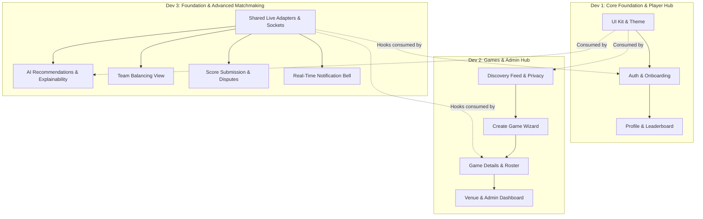

# PlayMatch — Web-Only Frontend Division of Work (3 Developers)

## 1. Overview & Strategy

The PlayMatch project is focusing **exclusively on the Web frontend (`apps/web/**`) and the shared foundation (`packages/shared/**`)**. No mobile implementation will be built.

To enable **3 developers to work simultaneously without merge conflicts or overlapping file edits**, the entire web application is split into three decoupled, vertical feature domains with clear module boundaries.

---

## 2. Team Architecture & Ownership Matrix

```
┌────────────────────────────────────────────────────────────────────────┐
│                        PLAYMATCH WEB PLATFORM                          │
├─────────────────────────┬────────────────────────┬─────────────────────┤
│      Developer 1        │      Developer 2       │    Developer 3      │
│  Design System, Auth,   │ Games Scheduling, Roster│ Advanced Matchmaking,│
│   Onboarding & Profile  │   Venues & Admin Hub   │ Results, Disputes & │
│                         │                        │  Live Notifications │
└─────────────────────────┴────────────────────────┴─────────────────────┘
```

| Developer | Core Domain | Directory & File Ownership |
|---|---|---|
| **Developer 1** | **Design System, Shell, Auth, Onboarding & Player Hub** | `apps/web/src/index.css`<br>`apps/web/tailwind.config.ts`<br>`apps/web/src/components/ui/**` (Base UI Kit)<br>`apps/web/src/components/layout/**` (Navbar, Shell, Theme)<br>`apps/web/src/pages/auth/**`<br>`apps/web/src/pages/onboarding/**`<br>`apps/web/src/pages/profile/**`<br>`apps/web/src/pages/leaderboard/**` |
| **Developer 2** | **Games Scheduling, Discovery Feed, Venues & Admin Suite** | `apps/web/src/components/games/**` (Game cards, filters, host controls)<br>`apps/web/src/pages/games/GamesDiscoveryPage.tsx`<br>`apps/web/src/pages/games/CreateGamePage.tsx`<br>`apps/web/src/pages/games/GameDetailsPage.tsx`<br>`apps/web/src/pages/games/MyGamesPage.tsx`<br>`apps/web/src/pages/venues/**`<br>`apps/web/src/pages/admin/**` |
| **Developer 3** | **Shared Foundation, Live Adapters, AI Recs, Results & Sockets** | `packages/shared/src/features/**/live.ts`<br>`packages/shared/src/query/**`<br>`packages/shared/src/realtime/**` (Socket client)<br>`apps/web/src/components/results/**`<br>`apps/web/src/components/teams/**`<br>`apps/web/src/components/explain/**`<br>`apps/web/src/components/notifications/**`<br>`apps/web/src/pages/games/RecommendationsTab.tsx` |

---

## 3. Detailed Developer Modules

### Developer 1: Design System, Auth, Onboarding & Player Hub

**Scope:** The platform look & feel, shared UI components, user session lifecycle, player onboarding wizard, and player profile & leaderboards.

#### Modules:
1. **Module 1.1: Design System, Theme & UI Kit**
   - Color variables in `src/index.css` (primary, card, border, text, success, warning, danger).
   - Tailwind theme tokens in `tailwind.config.ts`.
   - Theme toggle provider `ThemeContext.tsx` (Light / Dark mode with persistence).
   - Core UI Kit in `src/components/ui/`: `Button`, `Input`, `Select`, `Card`, `Badge`, `Modal`, `Toast`, `SkeletonLoader`, `EmptyState`, and `<DemoBadge />`.
   - Global App shell in `src/components/layout/AppLayout.tsx` & `Navbar.tsx`.
2. **Module 1.2: Authentication & Session Management**
   - `pages/auth/LoginPage.tsx` (Email/password form, validation, session restoration).
   - `pages/auth/RegisterPage.tsx` (Player and venue owner signup).
   - `pages/auth/ForgotPasswordPage.tsx` & `ResetPasswordPage.tsx`.
   - Routing guards in `routes/ProtectedRoute.tsx` (Redirects unauthenticated users to `/login`, and incomplete accounts to `/onboarding`).
3. **Module 1.3: 5-Step Player Onboarding Wizard**
   - `pages/onboarding/OnboardingWizard.tsx`:
     - Step 1: Basic Info (Display name, bio, avatar).
     - Step 2: Sports Selection (Badminton, Cricket, Football + self-assessed skill bands).
     - Step 3: Weekly Availability (Day selector + time slot sliders).
     - Step 4: Home Location & Travel Radius (Coordinates/address + km slider).
     - Step 5: Privacy Preferences (Profile and rating visibility).
4. **Module 1.4: Player Profile & Global Leaderboard**
   - `pages/profile/ProfilePage.tsx` (Personal sports Elo breakdown, peak ratings, match history, attendance reliability score & Bronze/Silver/Gold/Platinum badge).
   - `pages/leaderboard/LeaderboardPage.tsx` (Rankings table filtered by sport, showing rank, player name, rating, and win rate).

---

### Developer 2: Games Scheduling, Discovery Feed, Venues & Admin Hub

**Scope:** The match discovery feed, game lifecycle (creation, join/leave, roster, cancellation), venue management, and administrative moderation tools.

#### Modules:
1. **Module 2.1: Game Discovery Feed & Filters**
   - `pages/games/GamesDiscoveryPage.tsx` (Main feed with search bar, sport filter chips, date filter, distance slider).
   - `components/games/GameCard.tsx` (Sport badge, format, spots available, join policy, distance).
   - Privacy-aware distance display (exact distance for joined players; ~1 km coarsened centroid for spectators).
   - `pages/games/MyGamesPage.tsx` (Tabs: "Hosting", "Joined", "Past Games").
2. **Module 2.2: Game Creation & Scheduling Wizard**
   - `pages/games/CreateGamePage.tsx`:
     - Step 1: Sport & format selection.
     - Step 2: Date & start/end time pickers.
     - Step 3: Venue & court picker (with availability check) or custom location.
     - Step 4: Min/max players, join policy (`open` vs `approval`), visibility (`public` vs `private`).
3. **Module 2.3: Game Details, Roster & Host Tools**
   - `pages/games/GameDetailsPage.tsx`:
     - Game status header (`open`, `confirmed`, `in_progress`, `completed`, `cancelled`).
     - Exact court location revealed only when joined/hosting.
     - Action buttons: "Join Game", "Leave Game", "Share".
     - **Typed Extension Slots (placed by Dev 2, filled by Dev 3):**
       - `<GameTeamsSlot gameId={game.id} viewerRole={viewerRole} />`: mounts balanced team formation widget.
       - `<GameResultSlot gameId={game.id} viewerRole={viewerRole} />`: mounts score submission and verification widget.
       - Both slots import from `@/components/slots` and render `null` by default until Dev 3 provides feature implementations.
   - `components/games/RosterView.tsx` (Active players with host crown, waitlist promotion queue).
   - `components/games/HostControls.tsx` (Approve/reject join requests, cancel game with structured reason code modal).
4. **Module 2.4: Venue Owner Tools & Admin Moderation Dashboard**
   - `pages/venues/VenueManagementPage.tsx` (For venue owners: court schedule, operating hours, closures).
   - `pages/admin/AdminDashboardPage.tsx` (Guarded by `role === 'admin'`):
     - Metric cards: total users, active games, pending venues, open disputes.
     - User moderation table: search by name/email, suspend/reinstate accounts, update roles.
     - Dispute management panel: view disputed matches, force-resolve with custom scores, or void.

---

### Developer 3: Shared Integration, AI Recs, Results, Disputes & Real-Time

**Scope:** Shared API live adapters, TanStack Query hooks, WebSocket real-time client, AI recommendation cards, balanced team solver view, score submission & opponent verification.

#### Modules:
1. **Module 3.1: Live Feature Adapters & Real-Time Client (`packages/shared/**`)**
   - Replace mocks with live API callers in `packages/shared/src/features/**/live.ts`:
     - `getLiveRecommendations` -> `GET /api/v1/recommendations`.
     - `getLiveTeamSuggestion` -> `GET /api/v1/games/:id/teams`.
     - `getLiveGameResult` -> `GET /api/v1/games/:id/results`.
     - `getLiveNotifications` -> `GET /api/v1/notifications`.
     - `getLiveReliability` -> `GET /api/v1/reliability/me` (own score) or `GET /api/v1/reliability/:userId`.
   - Build `packages/shared/src/realtime/socket-client.ts`:
     - Typed Socket.IO client authenticating via access token.
     - Server emits event names: `'notification'` and `'notification.received'`.
     - Reliability tier values: `'bronze' | 'silver' | 'gold' | 'platinum'`.
   - Provide shared TanStack Query mutations (`useCreateGame`, `useJoinGame`, `useSubmitResult`, `useVerifyResult`, `useDisputeResult`, `useAdminResolveDispute`).
2. **Module 3.2: AI Recommendations & Explainability UI**
   - `pages/games/RecommendationsTab.tsx`:
     - Displays match score gauge (e.g., `92% Match`).
     - Confidence indicator (`High`, `Medium`, `Low`).
     - Multi-factor breakdown: skill gap, travel proximity, schedule fit, host reliability.
     - Bulleted reasons ("Within 3 km of home", "Matched with 1500 Elo players").
   - `components/explain/DecisionExplanationModal.tsx` ("Why this game?" and "Why this rating change?" modals).
3. **Module 3.3: Team Balancing & Solver View**
   - `components/teams/TeamBalancingView.tsx`:
     - Side A vs. Side B side-by-side roster breakdown.
     - Rating totals and balance delta indicator.
     - Host action button: "Regenerate Balanced Teams" (snake draft Elo solver).
4. **Module 3.4: Match Results, Opponent Verification & Disputes**
   - `components/results/SubmitScoreModal.tsx` (Host/participant proposes side scores & notes).
   - `components/results/VerificationBanner.tsx` (For players in `whoMustActNext`: "Confirm & Verify" vs "Dispute").
   - `components/results/DisputeModal.tsx` (Dispute submission for contested calls).
   - `components/results/ResultHistoryCard.tsx` (Displays verified score and Elo deltas `+16` / `-12`).
5. **Module 3.5: Real-Time Notification System**
   - `components/notifications/NotificationBell.tsx` (Live unread badge counter).
   - `components/notifications/NotificationDrawer.tsx` (List of notifications, mark as read, mark all as read, deep link to games).

---

## 4. Simultaneous Development Workflow & Contracts



### Shared Integration Contracts:
1. **Design Tokens & UI Kit**: Developer 1 completes the base UI Kit (`Button`, `Card`, `Badge`, `Modal`) first so Developers 2 and 3 use identical styling.
2. **API Data Envelope**: All API calls unwrap `{ success: true, data: T }`. Developer 3 guarantees all live adapters return typed `data`.
3. **Feature Seams (`isMock`)**: Developer 3 exposes `isMock` from all feature hooks; Developers 2 and 3 embed `<DemoBadge isMock={isMock} />` whenever `isMock=true`.

---

## 5. First Immediate Task for Each Developer

- **Developer 1**: Create `apps/web/src/index.css`, `ThemeContext.tsx`, and the UI kit components in `apps/web/src/components/ui/` (`Button.tsx`, `Card.tsx`, `Badge.tsx`, `DemoBadge.tsx`, `Modal.tsx`).
- **Developer 2**: Create `apps/web/src/components/games/GameCard.tsx` and the discovery feed structure in `apps/web/src/pages/games/GamesDiscoveryPage.tsx`.
- **Developer 3**: Implement `packages/shared/src/features/**/live.ts` with real API calls and implement `packages/shared/src/realtime/socket-client.ts`.
